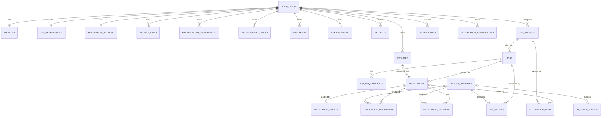

# Entity relationships

## Delete behavior

| Parent deleted | Effect |
| --- | --- |
| auth user | Everything owned by the user is deleted (cascade) |
| job | Requirements, scores, application, documents, answers, events deleted |
| application | Documents, answers, events deleted; `automation_runs.application_id` set null (run history kept) |
| job source | `jobs.source_id` and `automation_runs.job_source_id` set null (jobs kept) |
| resume | `applications.resume_id` set null |
| prompt version | Blocked (`restrict`) while any output references it — prompts are retired with `is_active = false`, never deleted |

Composite FKs `(x_id, user_id)` guarantee both rows belong to the same user.
